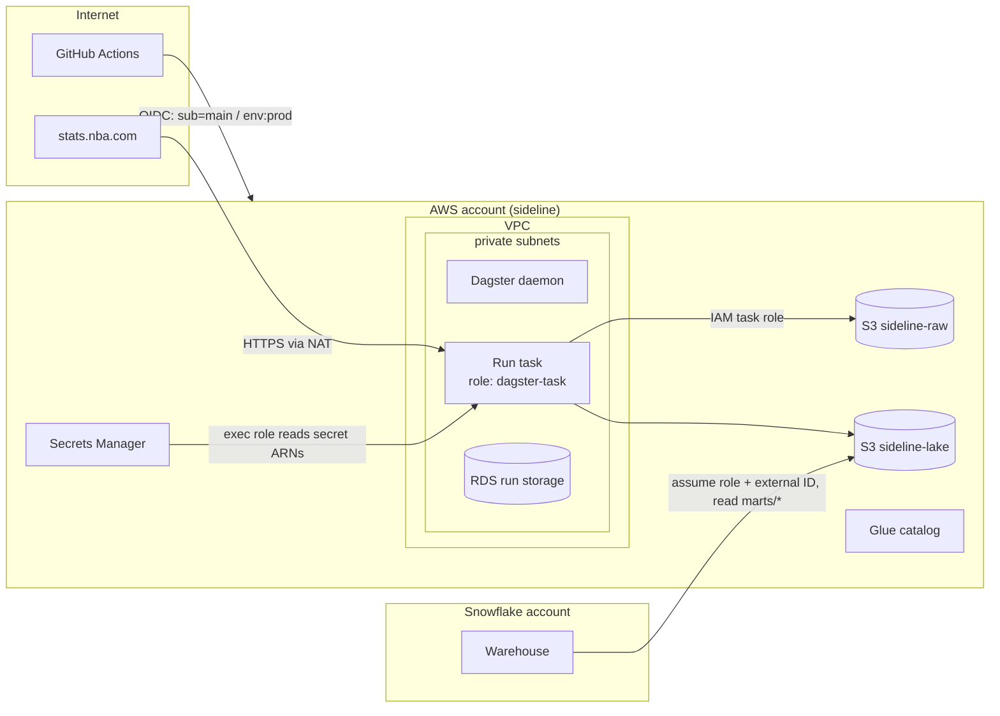

# M10.11 · Security-boundary architecture diagram

> **Ticket:** [#141](https://github.com/Dfscashline21/sideline/issues/141) ·
> **Mode:** hand · **Time:** 2 hours ·
> **Needs:** M10.3 to M10.8 deployed (draw what exists, not what you planned)

## Why this matters

In a system design interview, the security question is usually "where
are your trust boundaries?" A diagram that shows **networks, identities
and data flows together** answers it in one look: what's on the
internet, what's private, which role each component uses, and where
data crosses from one zone into another. It's also the diagram a security
reviewer at a real company asks for before approving anything.

## What you'll produce

A security-boundary diagram in the **README** (the acceptance criterion),
written as code so it's versioned and reviewable, plus a short legend.

## What the diagram must show

| Layer | Examples from Sideline |
|---|---|
| **Boundaries** | Internet · AWS account · VPC · public subnets · private subnets · GitHub · Snowflake's account |
| **Components** | ECS services and run tasks, RDS, S3 buckets (raw, lake), Glue catalog, Secrets Manager, NAT/endpoints |
| **Identities** | Execution and task roles, deploy roles (OIDC), Snowflake reader role, analyst DB role |
| **Data flows** | stats.nba.com → ingestion → raw → lake → marts → Snowflake; secrets → tasks; CI → AWS |
| **Controls on each crossing** | TLS, IAM role + external ID, OIDC `sub` condition, security group, bucket policy, masking view |

## Steps

### 1. Inventory from the real system (30 min)

Don't draw from memory: list what exists.

```bash
terraform -chdir=infra/terraform/envs/dev state list
aws ec2 describe-security-groups --filters Name=tag:project,Values=sideline \
  --query 'SecurityGroups[].{name:GroupName,in:IpPermissions}'
```

Use your M10.6 inventory table for roles and trust.

### 2. Mark every boundary crossing (30 min, on paper)

For each data flow, ask: *does it cross a boundary?* (internet → VPC,
AWS → Snowflake, GitHub → AWS, private → public subnet.) For each
crossing, write **who authenticates whom, and how**. These are the
interesting edges; label them on the diagram.

<details>
<summary>Hint · The crossings people forget</summary>

- **Outbound to the NBA API:** your tasks call the internet. Via NAT, or
  via public IPs after M10.10?
- **Snowflake → your S3:** Snowflake's AWS account assumes *your* role. An
  inbound trust from another company's account.
- **GitHub → AWS:** OIDC. GitHub is outside your account, but its tokens
  become roles inside it.
- **You → the Dagster UI:** how? (M10.4 decision.)
- **Logs:** data flows into CloudWatch too, and logs can contain PII (M10.8).

</details>

### 3. Draw it as code (45 min)

GitHub renders [Mermaid](https://docs.github.com/en/get-started/writing-on-github/working-with-advanced-formatting/creating-diagrams)
diagrams in Markdown, so the diagram lives in the README as text. A
starting skeleton, which you'll need to correct to match your system:

````markdown

````

Style the boundaries so they stand out (Mermaid `subgraph` blocks), and
label every edge that crosses one with its control.

### 4. Add a legend and a threat list (15 min)

Under the diagram, add a short table: for each boundary crossing, the
control and **one way it could fail** (e.g. "OIDC trust uses `StringLike
repo:*` → any branch deploys"). That last column turns a picture into a
security review.

### 5. Check it against reality

Pick three edges and prove them:

- An ECS run task's role: the console or `aws ecs describe-tasks` shows
  the task role ARN on the diagram.
- The Snowflake trust: the role's trust policy shows the principal and
  external ID condition.
- A security group: RDS accepts only the Dagster security group.

✅ **Checkpoint:** three edges verified; any mismatch fixed in the diagram
(or in the infrastructure, if the diagram was right and the infra wrong).

## Gotchas

- **Diagrams rot.** Add a line under it: "Last verified against
  Terraform state on YYYY-MM-DD". Update it in the same PR as any change
  that adds a role or a boundary crossing (M10.10 probably already did).
- **Too much detail** hides the boundaries. One box per *kind* of thing
  (one "run task", not one per league).
- **Mermaid syntax errors** render as an error block on GitHub. Preview
  in the PR's "Rich diff" or on [mermaid.live](https://mermaid.live).

## Done when

- [ ] Diagram in the README, as Mermaid (or an image whose source is committed)
- [ ] Shows networks/boundaries, roles, and data flows
- [ ] Every boundary crossing labelled with its control
- [ ] Legend with one failure mode per crossing
- [ ] Three edges verified against the live system; date of verification noted
- [ ] PR merged with `Closes #141`

## Ship it

```bash
git switch -c m10.11-security-diagram
git add README.md
git commit -m "M10.11: security-boundary architecture diagram"
```

## Check yourself

1. Point to every place on your diagram where another organisation's
   identity becomes an identity in your account.
2. Which boundary crossing has the weakest control, and what would you change?
3. Why is "the diagram is code in the README" better than a PNG?
