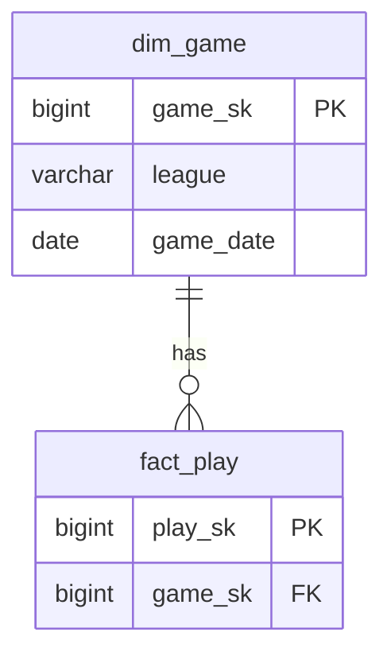
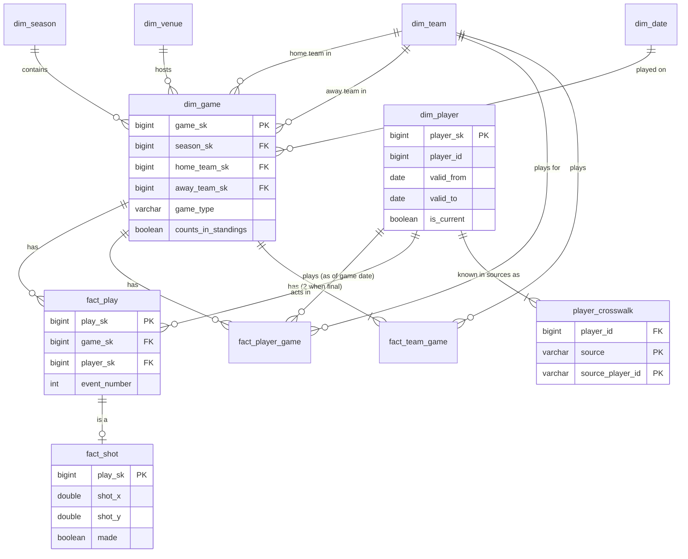

# M3.6 · Draw the ERD

> **Ticket:** [#51](https://github.com/Dfscashline21/sideline/issues/51) ·
> **Mode:** hand · **Time:** 90 min ·
> **Needs:** M3.2 to M3.5 merged

## Why this matters

The ERD is the picture an interviewer or new teammate understands in
ten seconds. Drawing it also catches design mistakes the prose hides: a
fact with no path to `dim_season`, two dimensions that both claim to own
"team", a many-to-many you didn't notice. Labelling every relationship
with its cardinality forces you to decide each one.

## What you'll produce

`docs/design/erd.md`: a Mermaid diagram of the full star schema, every
relationship labelled with cardinality, rendered on GitHub.

## Why Mermaid

Mermaid diagrams are text inside a Markdown code block that GitHub
renders as a picture. They diff in pull requests and change with the
model. dbdiagram.io is the alternative the ticket allows. It looks
nicer, but the source lives outside the repo unless you export it.
The course default is Mermaid.

## Steps

### 1. Learn the notation (20 min)

**Read:** [Mermaid entity relationship diagrams](https://mermaid.js.org/syntax/entityRelationshipDiagram.html).

Each relationship line has a cardinality marker on each end:

| Marker | Meaning |
|---|---|
| `\|\|` | exactly one |
| `\|o` / `o\|` | zero or one |
| `}\|` / `\|{` | one or more |
| `}o` / `o{` | zero or more |

`dim_game ||--o{ fact_play : "has"` reads "one game has zero or more
plays; each play belongs to exactly one game". The quoted text is the
relationship label.

Paste this into the [Mermaid live editor](https://mermaid.live) to
see it render:



### 2. Sketch on paper first (20 min)

Facts in the middle, dimensions around them. For each fact, draw a line
to every dimension it references. For each line, write the cardinality
at both ends **from your grain statements** (M3.2), not from intuition.

<details>
<summary>Hint 1 · Nudge: the awkward relationships</summary>

- `fact_shot` and `fact_play`: is a shot a separate thing, or a subset of
  plays? What's the cardinality, and which side can be zero?
- `fact_player_game` to `dim_player` with SCD2: does the fact point at
  one version (`player_sk`) or at the person (`player_id`)? Your M3.3
  choice decides how you draw it.
- `player_crosswalk`: many source IDs for one Sideline `player_id`.
- `dim_game` references `dim_team` **twice** (home and away). Draw both,
  with different labels.

</details>

### 3. Write the Mermaid (40 min)

Create `docs/design/erd.md` with a short intro and the diagram. Include
for each table: the key (`PK`), foreign keys (`FK`) and the few columns
that explain it. The full column lists live in `data-model.md`; the ERD
is the map, not the inventory.

<details>
<summary>Solution: a partial ERD (complete it with your own tables)</summary>



Things to notice:

- `fact_play ||--o| fact_shot`: every shot is exactly one play; a play is
  zero or one shot.
- `dim_game ||--|{ fact_team_game`: at least one team row per game.
  Postponed games have none, so is `|{` actually right? Decide based on
  your M3.2 grain, and fix the marker if not.
- Mermaid has no special notation for SCD2. Show `valid_from` and
  `valid_to`, and say in the label that the join is "as of game date".
- Mermaid can't draw a relationship to a *non-key* column, so the
  `player_id`-based crosswalk link is approximate. Note it in the text.

</details>

### 4. Check it renders and reads

Push the branch and open `docs/design/erd.md` on GitHub. Then check:

- Every fact connects to `dim_game`, and through it to `dim_season` and `dim_date`.
- Every line has a label and both cardinality markers.
- No dimension connects to another dimension unless you meant it
  (snowflaking). `dim_game → dim_team` is deliberate. Say so.

✅ **Checkpoint:** the diagram renders on GitHub (not just in the live
editor), and a friend can tell you the grain of `fact_player_game` from
it.

### 5. Link it

Link `erd.md` from `data-model.md` and from the README's Architecture
section (M0.6 placeholder).

## Ship it

```bash
git switch -c m3.6-erd
git add docs/design/
git commit -m "M3.6: star schema ERD in Mermaid"
```

PR with `Closes #51`.

## Gotchas

- **Large diagrams get unreadable.** If it's a hairball, split it in two:
  one diagram for game-level facts, one for players and identity.
- **A Mermaid syntax error replaces the whole diagram** with an error
  message on GitHub. Check the live editor first, where the error points
  at the line.
- **Entity names can't contain spaces or hyphens.** Use the snake_case
  table names.

## Done when

- [ ] ERD committed to `docs/design/erd.md`
- [ ] Every table from M3.2 present
- [ ] Every relationship labelled, with cardinality on both ends
- [ ] Renders on GitHub, linked from the data model doc and README
- [ ] PR merged with `Closes #51`

## Check yourself

1. Read `dim_game ||--o{ fact_play` aloud in English.
2. Why does `dim_game` link to `dim_team` twice?
3. What's the cardinality between `fact_play` and `fact_shot`, and why
   is one end "zero or one"?
